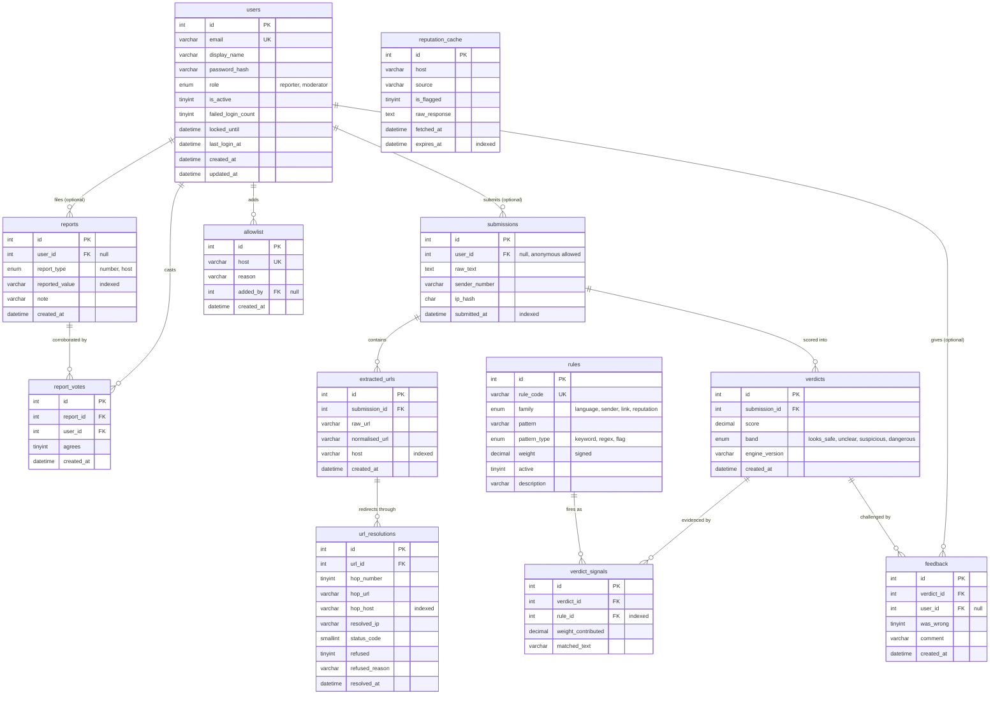

# SafeCedi, Entity Relationship Diagram

OWNER: M2 (Data & Backend Core)

Matches `database/schema.sql`. GitHub renders the diagram below
automatically.

## Notes

**Primary keys are all `id`.** M1 set that convention with `users`, so the
rest follow it. Foreign keys carry the parent's name, `user_id`,
`submission_id`, and so on.

**Everything hangs off `submissions`,** which is why that table is
deliberately thin. One submission has many URLs, one URL has many redirect
hops, one verdict has many signals.

**`verdict_signals` is the table the product rests on.** The evidence panel,
the rule-health dashboard and the re-score path all read out of it. It
stores the matched text and the weight as applied at the time, so an old
verdict still explains itself after a weight is retuned.

**`reputation_cache` stands alone.** It is keyed by host and source rather
than by a foreign key, because the same host gets looked up by submissions
that have nothing to do with each other.

**Anonymous use.** `submissions.user_id`, `reports.user_id` and
`feedback.user_id` are all nullable, because the plan allows submitting and
reporting without an account.

**Deletes.** A submission cascades to its URLs, resolutions, verdict and
signals, since none of those mean anything on their own. Deleting a user
sets their rows' `user_id` to NULL instead, so the evidence they
contributed survives. `verdict_signals` does **not** cascade from `rules`,
on purpose: a rule cannot be deleted while verdicts still cite it, or old
evidence would quietly lose its reasons.

**The labelled corpus is not a table.** It lives in `database/corpus.csv`,
because it is test data rather than user data and M5's harness reads it
directly. Raise it with the group before adding a twelfth table.